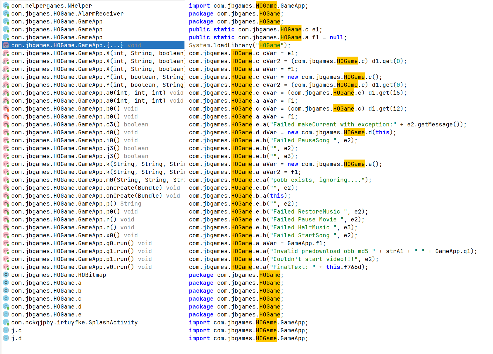
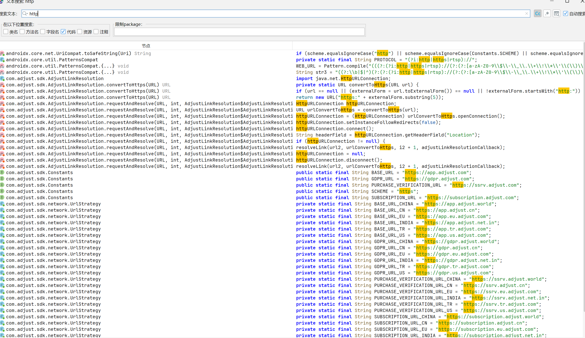
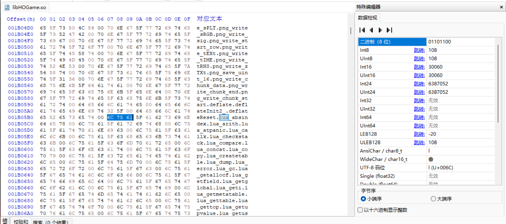
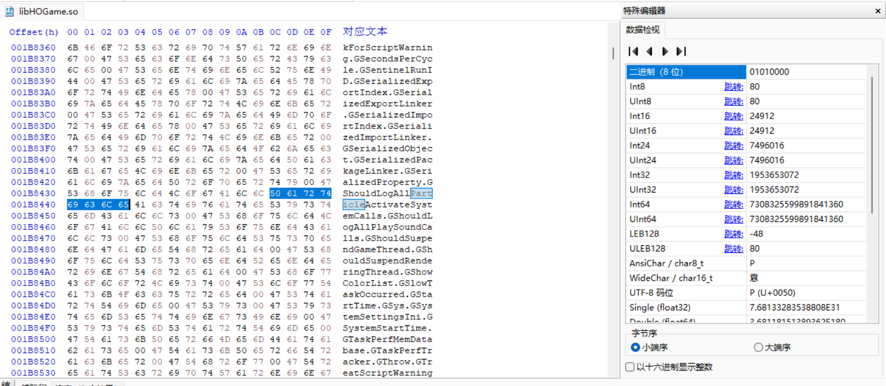

# Game-Protocol-Reversing-and-Engine-Fingerprinting

## 🎯 Motivation & Objective

Have you ever wondered what truly lies beneath the glossy UI of a mobile game? How does the game engine know exactly which image to render when you summon a pet, and how are thousands of assets organized inside a single APK file?

This project is driven by pure technical curiosity: **to demystify the internal architecture of an Android game and understand how its resources interact with the underlying engine.**

Unlike standard applications that simply unpack their assets, this game employs a custom UE3 engine and aggressively obfuscates its resources. The primary objectives of this repository are:

1.  **Deconstruct the APK:** To explore the directory structure and trace the execution flow from the Java layer (`classes.dex`) down to the native C++ layer (`libHOGame.so`).
2.  **Fingerprint the Engine:** To analyze the binary file and identify the core rendering and logic engines (e.g., Unreal Engine 3, Lua VM) buried within.
3.  **Trace Asset Pipelines:** To investigate how the game's visual and audio resources are encoded, disguised, and mapped. Specifically, understanding how the engine parses its custom binary formats (e.g., custom magic numbers, zlib-compressed chunks) during runtime.
4.  **Bridge Network and Assets:** To connect the dots between the network protocol (how the server tells the client what to load) and the local asset files (how the engine actually finds and loads them).

This is a journey of peeling back the layers of obfuscation to see the raw, unadulterated mechanics of a custom game engine.

## Phase 1: APK Extraction & Engine Fingerprinting

### Step 1: Unpacking the APK & Directory Inspection
*   **Tools Used**: WinRAR / 7-Zip / MT Manager
*   **Action**: Treated the game `.apk` file as a standard `.zip` archive and extracted it.
*   **Purpose & Finding**: To quickly investigate the asset structure. We discovered that inside the `lib` directory, there is only one massive 41MB dynamic library: `libHOGame.so`. Furthermore, in the `assets` directory, we found a large number of files with numeric names (e.g., `1527585152.ast.png`) and a folder named `DataAndroid`. This initially indicated that the game assets are heavily packaged or obfuscated.

```
📦 game_apk_extracted/
├── 📁 assets/
│   ├── 📁 Audio/                  # Game background music and sound effects (音效)
│   ├── 📁 DataAndroid/            # 🎯 Core target: Custom UE3 asset chunks (核心资产包)
│   │   ├── 📄 884290.ast.png      # Renamed UE3 binary packages (伪装成图片的资源包)
│   │   ├── 📄 997926831.ast.png   # Contains custom magic number (86 C7 E4 47)
│   │   ├── 📄 1527585152.fst.png  # Fragmented data chunks (碎片数据块)
│   │   └── ......
│   ├── 📁 Music/                  # Music tracks (音乐)
│   ├── 📄 54107989.mst.png        # Renamed Music file (伪装后的音乐文件)
│   ├── 📄 813231027.mst.png       # Music file
│   └── ......
│
├── 📁 lib/                        # Native Libraries (C++ 动态链接库)
│   └── 📁 arm64-v8a/
│       └── ⚙️ libHOGame.so        # 🎯 41MB Custom UE3 Engine (自研/魔改的虚幻3引擎核心)
│                                  # Contains: Lua VM, UE3 classes, Socket logic
│
├── 📁 kotlin/                     # Kotlin metadata (Kotlin 元数据目录)
│
├── 📁 META-INF/                   # APK signature and manifest (签名验证信息)
│
├── 📁 res/                        # Standard Android resources (安卓标准资源)
│
├── 📄 AndroidManifest.xml         # App permissions and components (安卓应用清单)
├── 📄 billing.properties          # Google Play in-app billing config (谷歌内购配置)
├── 📄 classes.dex                 # 7.9MB Java/Kotlin bytecode (Java 层可执行代码)
│
├── 📄 firebase-encoders.properties# 
├── 📄 play-services-*.properties  # Third-party Google SDK configs (谷歌服务SDK配置)
├── 📄 transport-api.properties    # 
├── 📄 resources.arsc              # Compiled Android resource mapping (编译后的资源映射表)
└── 📄 DebugProbesKt.bin           # Debug tools metadata
```

### Step 2: Analyzing `classes.dex` (Java Layer Logic)
*   **Tools Used**: JADX-GUI (Open-source decompiler)
*   **Action**: Dragged the `.apk` directly into JADX-GUI and waited for the decompilation process to finish.
*   **Purpose & Finding**: To examine the game's entry point and loading logic. Inside the `com.jbgames.HOGame` package, we found the `GameApp` class, which contains a critical line of code: `System.loadLibrary("HOGame");`. This proves that the game loads the 41MB C++ native library upon startup. Furthermore, we noticed that core network requests and gameplay logic are entirely absent in the Java layer, indicating that they are all handled deep within the C++ code.

<div align="center">
  
  <br>
  <em>Figure 1: Inspecting the GameApp class in JADX. Note the native library loading and obfuscated code.</em>
</div>

## Key Findings from the screenshot:
1.  **Native Engine Entry Point**: In the `com.jbgames.HOGame.GameApp` class, we found the critical line: `System.loadLibrary("HOGame");`. This proves that the Java layer is merely a wrapper for the Android lifecycle (handling music/video state), and all core logic, networking, and game loops are executed by the 41MB C++ native library (`libHOGame.so`).
2.  **Obfuscation Detected**: The class names and variables are heavily obfuscated (e.g., `com.jbgames.HOGame.a`, `cVar`, `f1`), indicating that the developers actively tried to hinder static analysis.

<div align="center">
  
  <br>
  <em>Figure 3: Global search for "http" in JADX reveals only third-party analytics SDKs (Adjust), confirming that the game's core network protocol and backend APIs are completely absent from the Java layer.</em>
</div>

## Key Findings from the screenshot:
1.  **Missing Core Logic**: A global search for `http`, `api`, or Socket keywords returned only third-party SDKs (like Adjust), confirming that the actual network communication is completely hidden inside the native C++ layer, the libHOGame.so in folder lib.

### Step 3: Reverse Engineering the `.so` File (Engine Fingerprinting)
*   **Tools Used**: HxD (A lightweight hex editor)
*   **Action**: Opened `libHOGame.so` in HxD and used `Ctrl+F` to search for plain-text strings.
*   **Purpose & Finding**: **This was the decisive step in identifying the game engine.** Since `.so` is compiled machine code, we cannot read the source directly, but we can search for string constants. We found:
    *   `luaL_loadbuffer`, `lua_`: Proving the engine embeds a Lua scripting virtual machine.
    *   `ParticleSystem`, `AnimSequence`, `SlateUI`: These are exclusive class names from **Unreal Engine 3 (UE3)**.
    *   Therefore, we confirmed that this game is developed based on a heavily customized version of the UE3 engine.

<div align="center">
  
  <br>
  <em>Figure 3: HxD search results showing Lua APIs inside libHOGame.so.</em>
</div>

<div align="center">
  
  <br>
  <em>Figure 4: HxD search results showing UE3 class names inside libHOGame.so.</em>
</div>


### Step 4: Asset File Header Analysis (Capturing the Magic Number)

**From Engine to Assets: The Transition**

Now that we have confirmed the core engine is a customized version of UE3 and that it embeds Lua and Socket logic within `libHOGame.so`, the next logical step is to investigate how the engine interacts with its visual and data assets. If the engine handles all the heavy lifting, how are the actual game resources (models, textures, configurations) stored and packaged? 

To answer this, we shift our focus from native binary analysis to the `assets` directory. Since standard UE3 tools rely on specific file headers, our first task is to inspect how the game packages these assets and whether it uses standard structures or its own obfuscation techniques.
*   **Tools Used**: HxD / Python Scripts
*   **Action**: Opened several `.ast.png` and `.fst.png` files in the `DataAndroid` directory and inspected the first 4 bytes of their headers.
*   **Purpose & Finding**: We discovered that all files consistently start with `86 C7 E4 47`. This is **NOT** the standard UE3 magic number (which should be `C1 83 2A 9E`). This is a custom "fake magic number" applied by the game developers. By scanning the directory, we confirmed that the vast majority of the asset files share this custom header to bypass standard unpacking tools.

## What is the Standard file looks like ?
Before we inspect the game's files, let's establish what a standard, pristine Unreal Engine 3 (UE3) package (`.upk`) should look like at the binary level. 

In a standard UE3 architecture, the engine relies heavily on a fixed binary structure. The first 4 bytes must always be the standard Magic Number (Tag), followed by the engine version, and then a comprehensive "Summary" (directory) that tells the engine where to find the Name Table, Import/Export tables, and the actual Data Payload.

**Standard UE3 Package Structure (Normal State):**
```text
+-------------------------------------------------------------+
| Offset | Hex Bytes     | Field Name          | Description   |
+--------+---------------+---------------------+---------------+
| 0x00   | C1 83 2A 9E   | Magic Number (Tag)  | Identifies UE3|
| 0x04   | C1 0F 00 00   | Engine Version      | e.g., 0x0FC1  |
| 0x08   | XX XX XX XX   | Header Size         | Size of Summ. |
| 0x0C   | XX XX XX XX   | Name Table Offset   | Pointer to Names|
| ...    | ...           | ...                 | ...           |
+--------+---------------+---------------------+---------------+
```

*(In standard UE3, `C1 83 2A 9E` is the absolute "ID card" of the file. Without it, the engine and any unpacking tool like UModel will immediately reject the file.)*

However, during our analysis, we captured a completely different scenario:

*   **Tools Used**: HxD / Python Scripts
*   **Action**: Opened several `.ast.png` and `.fst.png` files in the `assets/DataAndroid` directory and inspected the first 4 bytes of their headers.
*   **Purpose & Finding**: We discovered that all files consistently start with **`86 C7 E4 47`**. This is **NOT** the standard UE3 magic number.

By comparing the standard structure with our captured data, we found that the game developers had aggressively modified the engine:

*   **Fake Magic Number**: They replaced the standard `C1 83 2A 9E` with a custom tag `86 C7 E4 47`.
*   **Stripped Summary**: In many of the `.ast.png` files, the standard "Summary" directory was completely removed or obfuscated.
*   **Camouflaged Extension**: They renamed the `.upk` binaries to `.png` to trick basic asset scanners.

By scanning the entire directory, we confirmed that the vast majority of the asset files share this custom header. This explained why standard unpacking tools (like UModel) failed, as they were looking for a standard UE3 ID card that the developers had deliberately destroyed.

<div align="center">
  
  <br>
  <em>Figure 4: HxD showing the custom magic number "86 C7 E4 47" at the beginning of the asset files.</em>
</div>

### Step 5: Locating the Compressed Chunks & Decompression Attempt

Once we discovered the custom magic number (`86 C7 E4 47`), our next challenge was to extract the actual data. Since standard unpacking tools failed, we needed to manually trace how the engine processes the binary stream.

*   **Tools Used**: HxD / Python (`zlib` module)
*   **Action**: We manually dissected the file structure and used Python scripts to search for standard compression signatures across the binary data.

**Key Findings & Analysis:**

1.  **Locating the Zlib Header**: We scanned the `.ast.png` and `.fst.png` files for the standard Zlib header signature **`78 9C`**. Finding this confirmed that the raw data was compressed using the DEFLATE algorithm, but hidden deep inside the file rather than using standard UE3 compression wrappers.
2.  **Multi-Chunk Concatenation**: While inspecting the hex dump, we discovered that a single file contained multiple instances of the custom magic number `86 C7 E4 47`. For example, a file might start with the custom header, contain some uncompressed structural data (like the string `"None"`), and then suddenly begin a new block with `86 C7 E4 47` followed immediately by `78 9C` compressed data. 
3.  **The Offset Trap**: This multi-chunk structure explained why standard tools crashed. They expected a single, monolithic UE3 package, but instead, they encountered disjointed blocks of data. When UModel attempted to parse the file, it misread the offsets (e.g., the `pos=1A5` error), leading to memory allocation failures.
4.  **Python Decompression Attempt**: We wrote a Python script to locate the `78 9C` signature and apply `zlib.decompress()`. 
    *   *Result*: The decompression successfully outputted a massive stream of binary data containing plaintext UE3 class names (e.g., `ParticleSystem`, `HT_FX_pikaqiu`).
    *   *Limitation*: The script failed to extract the entire file because the Zlib block abruptly ended where the next `86 C7 E4 47` block began, resulting in partial data loss or `zlib.error` exceptions.

**Conclusion**: 
The game employs a custom **multi-chunk encapsulation** strategy. It strips the standard UE3 "Summary" header, compresses the remaining data with Zlib, and concatenates multiple independent blocks together under a single `.png` file. To fully extract the assets, a custom parser is required to iterate through each `86 C7 E4 47` marker and decompress the corresponding Zlib block independently.

<div align="center">
  
  <br>
  <em>Figure 5: Locating the "78 9C" Zlib header and the secondary custom magic number within the binary stream.</em>
</div>
